<a id="inizio"></a>

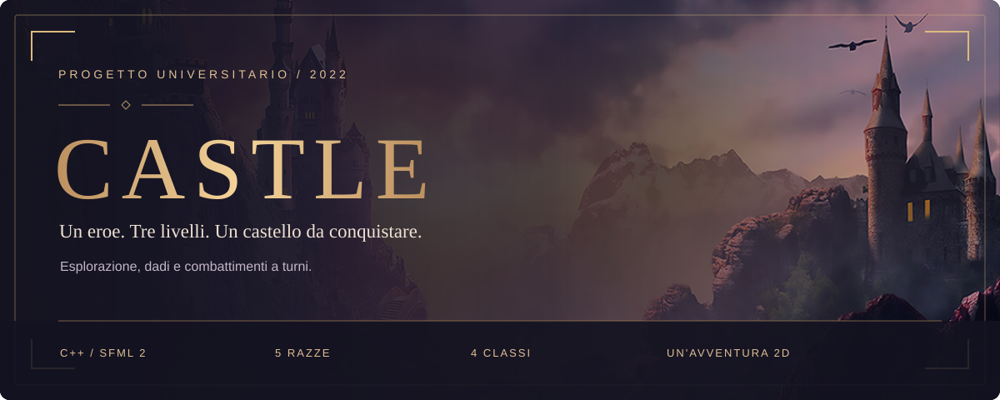

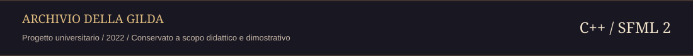

<p align="center"><strong>Entra nel castello di Ronkahudroth. Affronta i suoi guardiani. Libera Metalyn.</strong></p>

<p align="center">
  <a href="#la-missione">I. La missione</a> &nbsp; / &nbsp;
  <a href="#cronache-dal-castello">II. Le cronache</a> &nbsp; / &nbsp;
  <a href="#la-mappa-del-progetto">III. La fortezza</a><br>
  <a href="#preparare-la-spedizione">IV. I preparativi</a> &nbsp; / &nbsp;
  <a href="#la-forgia-compilazione-su-windows">V. La forgia</a> &nbsp; / &nbsp;
  <a href="#compilazione-con-dipendenze-gia-installate">VI. La seconda via</a><br>
  <a href="#comandi-di-gioco">VII. I comandi</a> &nbsp; / &nbsp;
  <a href="#prove-della-gilda">VIII. Le prove</a> &nbsp; / &nbsp;
  <a href="#inventario-delle-risorse-e-stato-del-progetto">IX. L'inventario</a><br>
  <a href="#ostacoli-lungo-il-cammino">X. Le insidie</a> &nbsp; / &nbsp;
  <a href="#crediti-e-licenze">XI. Gli artefici</a> &nbsp; / &nbsp;
  <a href="#note-per-la-pubblicazione-su-github">XII. Le cronache su GitHub</a>
</p>

> **Dal registro del 2022**<br>
> Progetto universitario in C++ e SFML, conservato a scopo didattico e dimostrativo. Un gioco di ruolo 2D tra esplorazione, creazione del personaggio e combattimenti a turni.

<p align="right"><a href="#inizio">Torna all’indice ↑</a></p>

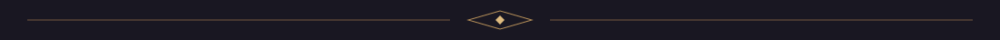

<a id="la-missione"></a>

## 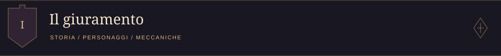

Il protagonista deve entrare nel castello del mindflayer Ronkahudroth e salvare la principessa Metalyn. Prima di iniziare l'esplorazione, il giocatore sceglie razza, classe, arma e armatura del proprio eroe.

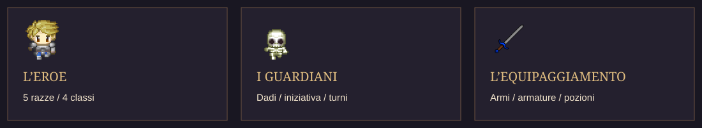

### Scegli da che parte scrivere la leggenda

| Il tuo eroe | Il castello | Le sfide |
| --- | --- | --- |
| 5 razze e 4 classi | Una mappa iniziale e 3 livelli | Iniziativa e combattimenti a turni |
| Armi, armature e pozioni | Statue, tesori e passaggi | Tiri di dado, punti vita e achievement |

Le funzionalità presenti nel codice comprendono:

- Cinque razze: umano, dragonborn, tiefling, elfo e nano.
- Quattro classi: barbaro, druido, guerriero e mago.
- Selezione di armi e armature con caratteristiche differenti.
- Una mappa iniziale e tre livelli del castello.
- Movimento, collisioni, interazione con statue e tesori, raccolta e utilizzo di pozioni.
- Combattimenti a turni con iniziativa, tiri di dado, punti vita e classe armatura.
- Inventario, schermata di pausa e achievement.

L'interfaccia e i messaggi del gioco sono in inglese.

<p align="right"><a href="#inizio">Torna all’indice ↑</a></p>


<a id="cronache-dal-castello"></a>

## 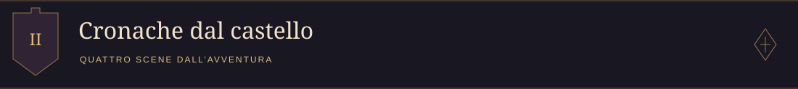

### I. Scegli il tuo eroe

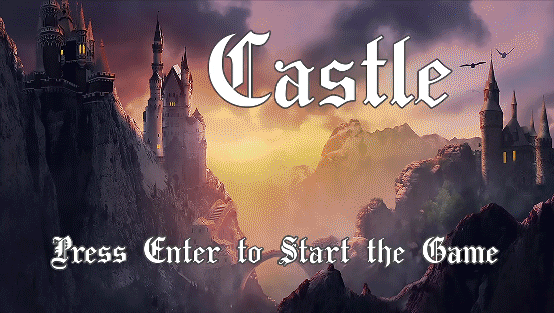

### II. Varca le mura

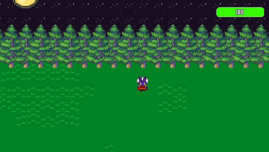

### III. Scopri i tesori

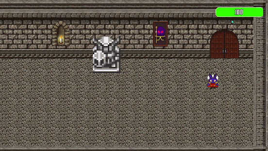

### IV. Affronta i guardiani

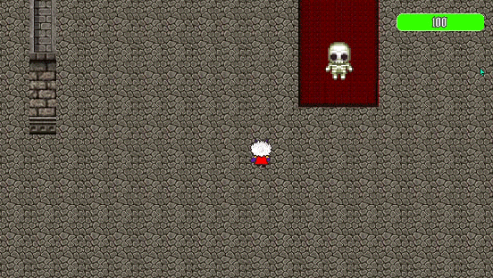

<p align="right"><a href="#inizio">Torna all’indice ↑</a></p>


<a id="la-mappa-del-progetto"></a>

## 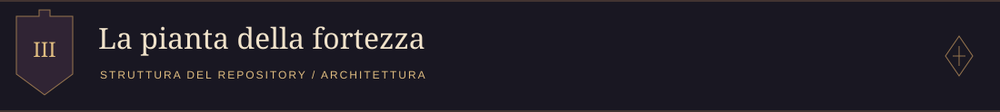

```text
Game/
├── src/
│   ├── main.cpp           Punto di ingresso
│   ├── core/              Finestra e ciclo di gioco
│   ├── states/            Menu, esplorazione, livelli, pausa e combattimento
│   ├── characters/        Personaggi, eroe e nemici
│   ├── items/             Armi, armature, pozioni e relativi creator
│   ├── animation/         Animazioni e rappresentazione grafica
│   ├── world/             Tile, mappe e oggetti interattivi
│   ├── achievements/      Achievement e notifiche Observer
│   └── utils/             Dadi
├── assets/
│   ├── images/            Sprite, texture, interfaccia e tile set
│   ├── Font/              Font e informazioni originali sulla licenza
│   └── mapXML/            Le quattro mappe XML
├── test/                  Test del progetto
│   └── lib/               Submodule GoogleTest
├── docs/images/           GIF dimostrative
├── vcpkg/                 Submodule per le dipendenze C++
├── CMakeLists.txt         Configurazione di compilazione
├── CMakeSettings.json     Configurazione per Visual Studio
├── .gitmodules            Definizione dei submodule
├── .gitignore             Esclusione di build e file locali
└── README.md
```

Header e implementazioni sono affiancati per responsabilità. Gli include del progetto sono relativi a `src/`.

La libreria statica `core` contiene il codice condiviso dal gioco e dai test. L'eseguibile `Game` utilizza `src/main.cpp`; l'eseguibile `runAllTests` esegue la suite GoogleTest. Gli stati derivano da `GameState`; `Playable` raccoglie funzionalità comuni all'esplorazione. I creator costruiscono armi e armature, mentre `Observable` e `Observer` gestiscono le notifiche degli achievement.

<p align="right"><a href="#inizio">Torna all’indice ↑</a></p>


<a id="preparare-la-spedizione"></a>

## 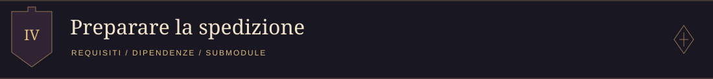

Requisiti e installazione per entrare nel castello.

- Git, per clonare il repository e inizializzare i submodule.
- Un compilatore con supporto C++11.
- CMake 3.16 o successivo. Per le dipendenze storiche del progetto è consigliato CMake 3.x.
- SFML **2.x**, con i componenti `system`, `window`, `graphics` e `network`.
- tinyxml2, disponibile a CMake tramite il relativo package di configurazione.
- GoogleTest, incluso come submodule in `test/lib`, se si compilano i test.
- Una sessione grafica per eseguire il gioco e i test che creano finestre SFML.

Il progetto nasce in ambiente Windows/Visual Studio. Le istruzioni principali qui sotto usano PowerShell e una compilazione x64. Il codice usa l'API di SFML 2 e non è compatibile direttamente con SFML 3. Il port SFML del submodule vcpkg incluso dichiara la versione 2.5.1.

### Recuperare il progetto e le dipendenze

Dopo aver clonato il repository, aprire un terminale nella sua cartella principale ed eseguire:

```sh
git submodule update --init --recursive
```

Questo comando recupera GoogleTest e vcpkg nelle revisioni registrate dal repository. Un archivio ZIP di GitHub non contiene il codice dei submodule: per seguire questa procedura utilizzare un clone Git.

<p align="right"><a href="#inizio">Torna all’indice ↑</a></p>


<a id="la-forgia-compilazione-su-windows"></a>

## 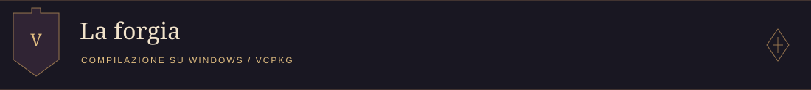

Installare Visual Studio o i Build Tools con il carico di lavoro **Sviluppo di applicazioni desktop con C++**, un Windows SDK e CMake. Eseguire i comandi seguenti in PowerShell dalla radice del repository.

### I / Preparare le dipendenze

```powershell
.\vcpkg\bootstrap-vcpkg.bat
.\vcpkg\vcpkg.exe install sfml:x64-windows tinyxml2:x64-windows
```

Mantenere coerenti l'architettura del compilatore e il triplet vcpkg. Questa procedura usa `x64-windows`.

### II / Configurare e compilare

```powershell
cmake -S . -B build -A x64 -DCMAKE_TOOLCHAIN_FILE=vcpkg/scripts/buildsystems/vcpkg.cmake -DVCPKG_TARGET_TRIPLET=x64-windows -DBUILD_TESTING=ON
cmake --build build --config Debug
```

L'opzione `-A x64` è destinata al generatore Visual Studio. Con Ninja utilizzare un ambiente di sviluppo MSVC x64, omettere `-A x64` e impostare `-DCMAKE_BUILD_TYPE=Debug` durante la configurazione.

Per compilare soltanto il gioco, sostituire `-DBUILD_TESTING=ON` con `-DBUILD_TESTING=OFF`. In questo caso GoogleTest non è necessario.

Il toolchain e il generatore vanno scelti alla prima configurazione. Se si cambia toolchain, generatore o architettura, utilizzare una nuova directory, per esempio `build-x64`, al posto di `build`.

### III / Avviare il gioco

Con il generatore Visual Studio, dalla radice del repository:

```powershell
.\build\Debug\Game.exe
```

Con Ninja l'eseguibile si trova normalmente in `build/Game.exe`.

> **Il punto di partenza**<br>
> La directory di lavoro deve essere la radice del repository, dove si trova `assets/`.

 Avviare il programma dal terminale come indicato, evitando di cambiare directory nella cartella dell'eseguibile. Il target CMake configura anche questa directory per il debugger di Visual Studio.

Per una build Release, usare `--config Release` e avviare `build/Release/Game.exe`.

<p align="right"><a href="#inizio">Torna all’indice ↑</a></p>


<a id="compilazione-con-dipendenze-gia-installate"></a>

## 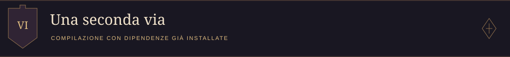

Se SFML 2 e tinyxml2 sono già disponibili al compilatore, vcpkg è facoltativo:

```sh
cmake -S . -B build -DBUILD_TESTING=ON
cmake --build build --config Debug
```

Se CMake non trova le librerie, aggiungere `-DCMAKE_PREFIX_PATH=<directory-di-installazione>` alla configurazione, sostituendo il segnaposto con il percorso effettivo. Le librerie devono essere compatibili con compilatore e architettura scelti.

Con un generatore a configurazione singola impostare anche `-DCMAKE_BUILD_TYPE=Debug`; il parametro `--config` serve ai generatori con più configurazioni. Su Linux l'eseguibile si trova normalmente in `build/Game` e va avviato dalla radice con `./build/Game`. L'esecuzione su piattaforme diverse da Windows non è stata verificata in questa riorganizzazione.

<p align="right"><a href="#inizio">Torna all’indice ↑</a></p>


<a id="comandi-di-gioco"></a>

## 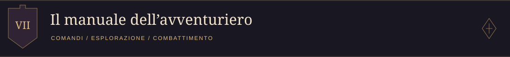

I comandi dipendono dalla schermata corrente; i messaggi a video indicano l'azione disponibile.

| Contesto | Tasto | Azione |
| --- | --- | --- |
| Schermata iniziale | <kbd>Invio</kbd> | Inizia il gioco |
| Selezione di razza, arma o armatura | Frecce sinistra/destra | Scorre le opzioni |
| Selezione della classe | Frecce su/giù | Scorre le classi |
| Menu di selezione | <kbd>Invio</kbd> | Conferma la scelta |
| Esplorazione | Frecce direzionali | Muove il personaggio |
| Area iniziale | <kbd>W</kbd> | Apre la scelta dell'equipaggiamento |
| Esplorazione | <kbd>A</kbd> | Interagisce, entra nel castello, usa le scale o avvia un combattimento quando richiesto |
| Statue e tesori | <kbd>S</kbd> | Raccoglie la pozione o chiude il messaggio dopo l'apertura |
| Esplorazione | <kbd>Invio</kbd> | Apre pausa e inventario |
| Inventario | Frecce direzionali | Seleziona una pozione |
| Inventario | <kbd>Invio</kbd> | Usa la pozione selezionata |
| Pausa | <kbd>Backspace</kbd> | Torna al gioco |
| Combattimento | <kbd>A</kbd> | Avvia o conclude lo scontro quando richiesto |
| Turno dell'eroe | <kbd>S</kbd> | Esegue l'attacco dell'eroe |
| Turno del nemico | <kbd>D</kbd> | Esegue l'attacco del nemico |
| Notifica di achievement | <kbd>Z</kbd> | Chiude la notifica |

<p align="right"><a href="#inizio">Torna all’indice ↑</a></p>


<a id="prove-della-gilda"></a>

## 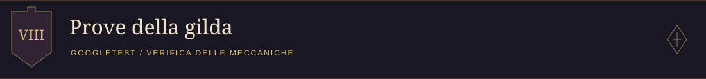

### Eseguire i test

I test coprono costruzione e caratteristiche di eroi e nemici, armi e armature, attacchi, pozioni, collisioni e achievement.

Dopo una compilazione con `BUILD_TESTING=ON`:

```sh
ctest --test-dir build -C Debug --output-on-failure
```

CTest imposta la radice del repository come directory di lavoro. È possibile avviare direttamente la suite da PowerShell:

```powershell
.\build\test\Debug\runAllTests.exe
```

Con un generatore a configurazione singola, il percorso è normalmente `build/test/runAllTests.exe` su Windows o `build/test/runAllTests` su Linux.

Alcuni test creano finestre SFML e caricano mappe e texture già durante l'inizializzazione: richiedono le risorse in `assets/` e una sessione grafica, quindi la suite non è predisposta per un ambiente senza display.

<p align="right"><a href="#inizio">Torna all’indice ↑</a></p>


<a id="inventario-delle-risorse-e-stato-del-progetto"></a>

## 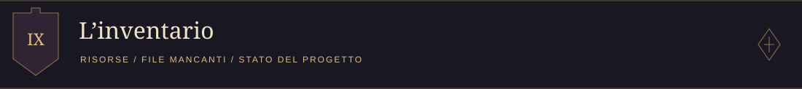

In `assets/` sono presenti **47 immagini**, le risorse del font TaylorGothic e **quattro mappe XML**: `PLMap.xml`, `FLMap.xml`, `SLMap.xml` e `TLMap.xml`. Le risorse sono state recuperate dalla precedente cartella `out/build/` e collocate fuori dalle directory di compilazione.

I percorsi nel codice e nelle mappe XML iniziano con `assets/` e vengono risolti rispetto alla directory di lavoro. Conservare i nomi e le maiuscole dei file, soprattutto su filesystem sensibili alle maiuscole.

> **Due oggetti mancano all’inventario**<br>
> Le risorse recuperate non comprendono le due immagini seguenti, ancora richieste dal codice:

| File | Utilizzo |
| --- | --- |
| `assets/images/other/potion.png` | Rappresentazione grafica delle pozioni |
| `assets/images/fight/background.png` | Sfondo della schermata di combattimento |

Per completare le risorse, ripristinare i file originali in questi percorsi. La loro assenza può produrre errori di caricamento e una rappresentazione grafica incompleta.

Durante la riorganizzazione sono stati verificati gli include interni e i riferimenti alle risorse disponibili. **La compilazione e l'esecuzione completa non sono state verificate**: nell'ambiente usato per la riorganizzazione CMake non ha trovato il package SFML. Le GIF mostrano il funzionamento del progetto originale e non certificano una nuova esecuzione della versione riorganizzata.

<p align="right"><a href="#inizio">Torna all’indice ↑</a></p>


<a id="ostacoli-lungo-il-cammino"></a>

## 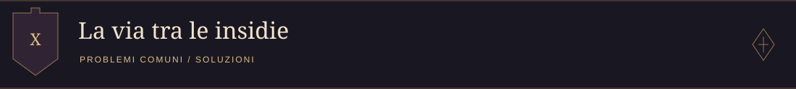

| Problema | Verifica o soluzione |
| --- | --- |
| CMake non trova `SFMLConfig.cmake` o `sfml-config.cmake` | Installare SFML 2 per il compilatore scelto e configurare il toolchain vcpkg o `CMAKE_PREFIX_PATH`. |
| CMake non trova tinyxml2 | Installare tinyxml2 e rendere disponibile a CMake la sua configurazione. |
| Manca `test/lib/googletest/CMakeLists.txt` | Eseguire `git submodule update --init --recursive`, oppure compilare con `BUILD_TESTING=OFF`. |
| CMake recente rifiuta le policy delle vecchie dipendenze | Utilizzare CMake 3.x, oppure aggiornare e verificare separatamente le dipendenze storiche. |
| L'avvio segnala DLL mancanti | Rendere accessibili le DLL SFML e delle relative dipendenze, accanto all'eseguibile o tramite `PATH`, usando la stessa architettura e configurazione della build. |
| Non vengono caricati font, texture o mappe | Avviare dalla radice del repository e controllare i percorsi in `assets/`; le due immagini elencate sopra sono ancora mancanti. |
| I test non funzionano su un server senza display | Eseguire la suite in una sessione grafica compatibile con SFML. |

<p align="right"><a href="#inizio">Torna all’indice ↑</a></p>


<a id="crediti-e-licenze"></a>

## 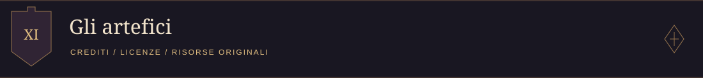

Il font TaylorGothic è attribuito a **Thor Christopher Arisland**. Le condizioni originali conservate in [assets/Font/TaylorGothic.txt](assets/Font/TaylorGothic.txt) indicano uso personale gratuito e una licenza da acquistare per l'uso commerciale.

Le dipendenze SFML, tinyxml2, GoogleTest e vcpkg mantengono le rispettive licenze. Non è presente un file `LICENSE` per il codice del progetto. Provenienza e condizioni di utilizzo delle immagini devono ancora essere documentate; il contesto universitario non costituisce una licenza delle risorse.

<p align="right"><a href="#inizio">Torna all’indice ↑</a></p>


<a id="note-per-la-pubblicazione-su-github"></a>

## 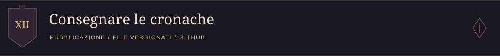

Le cartelle da versionare comprendono `src/`, `assets/`, `test/` e `docs/`, insieme ai file di configurazione. `test/lib` e `vcpkg` sono submodule: Git registra i riferimenti ai repository delle dipendenze.

`.gitignore` esclude `build/`, `out/`, `.vs/`, binari e impostazioni locali dell'IDE. Le risorse da pubblicare sono quelle in `assets/`; le copie rimaste in `out/build/` non sono necessarie nel repository. L'esclusione dei file generati dai nuovi commit non li rimuove dalla cronologia Git esistente.


<p align="right"><a href="#inizio">Torna all’indice ↑</a></p>

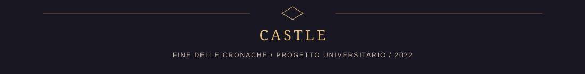
